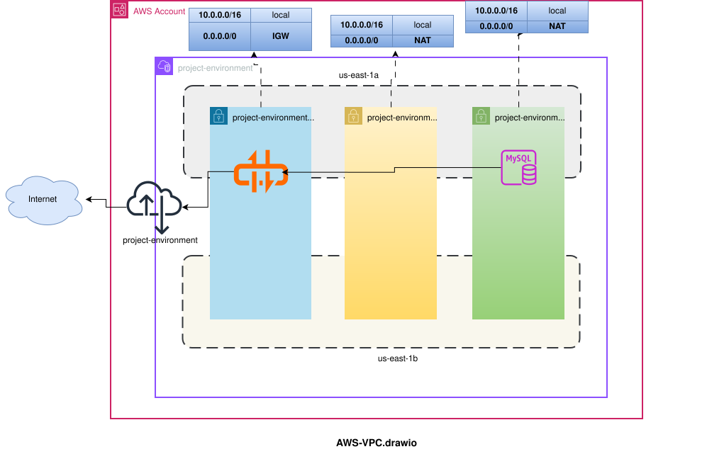
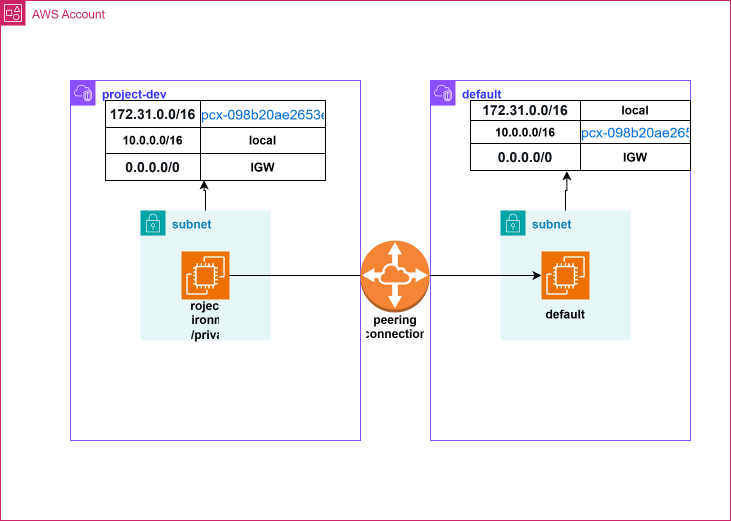

# terraform-aws-vpc

Reusable Terraform module that creates a production-style, three-tier AWS VPC: **public**, **private** and **database** subnets spread across two Availability Zones, with internet access through an Internet Gateway and a NAT Gateway, and optional peering to the default VPC.

Used by [roboshop-infra-dev](https://github.com/prudhvisaikoppaka/roboshop-infra-dev) to build the network for the RoboShop application.

## Architecture



### Routing



## What it creates

| Resource | Details |
|---|---|
| VPC | DNS hostnames enabled, default CIDR `10.0.0.0/16` |
| Internet Gateway | Attached to the VPC |
| Public subnets | One per CIDR you pass in, spread over the first 2 AZs, public IPs on launch |
| Private subnets | For application servers, outbound internet through the NAT Gateway |
| Database subnets | For databases, outbound internet through the NAT Gateway, no inbound internet access |
| Elastic IP and NAT Gateway | In the first public subnet |
| Route tables | One each for public, private and database subnets, with associations |
| VPC peering (optional) | To the account's default VPC, with routes added to all route tables in both directions |

All resources are tagged with `Project`, `Environment` and `Terraform = true`, and named `<project>-<environment>-<type>-<az>`.

## Usage

```hcl
module "vpc" {
  source = "git::https://github.com/prudhvisaikoppaka/terraform-aws-vpc.git?ref=main"

  project     = "roboshop"
  environment = "dev"

  public_subnet_cidrs   = ["10.0.1.0/24", "10.0.2.0/24"]
  private_subnet_cidrs  = ["10.0.11.0/24", "10.0.12.0/24"]
  database_subnet_cidrs = ["10.0.21.0/24", "10.0.22.0/24"]

  is_peering_required = true
}
```

## Inputs

| Name | Type | Default | Required | Description |
|---|---|---|---|---|
| `project` | string | | yes | Project name, used in names and tags |
| `environment` | string | | yes | Environment name, for example `dev` or `prod` |
| `cidr_block` | string | `10.0.0.0/16` | no | CIDR block of the VPC |
| `public_subnet_cidrs` | list(string) | | yes | CIDRs of the public subnets, one per AZ |
| `private_subnet_cidrs` | list(string) | | yes | CIDRs of the private subnets, one per AZ |
| `database_subnet_cidrs` | list(string) | | yes | CIDRs of the database subnets, one per AZ |
| `is_peering_required` | bool | `false` | no | Create a peering connection to the default VPC |
| `vpc_tags`, `igw_tags`, `public_subnet_tags`, `private_subnet_tags`, `database_subnet_tags`, `eip_tags`, `nat_gateway_tags`, `public_route_table_tags`, `private_route_table_tags`, `database_route_table_tags`, `vpc_peering_tags` | map(string) | `{}` | no | Extra tags for each resource |

## Outputs

| Name | Description |
|---|---|
| `vpc_id` | ID of the VPC |
| `public_subnet_ids` | IDs of the public subnets |
| `private_subnet_ids` | IDs of the private subnets |
| `database_subnet_ids` | IDs of the database subnets |

## Design notes

- **One NAT Gateway** keeps costs low for dev environments. For production, one NAT Gateway per AZ removes the single point of failure.
- Database subnets get their own route table, so their routing can be restricted separately from the application tier.
- #Peering to the default VPC lets tools running there (for example a Jenkins or Ansible server) reach the new VPC privately.

## Requirements

- Terraform 1.x
- AWS provider 6.x
